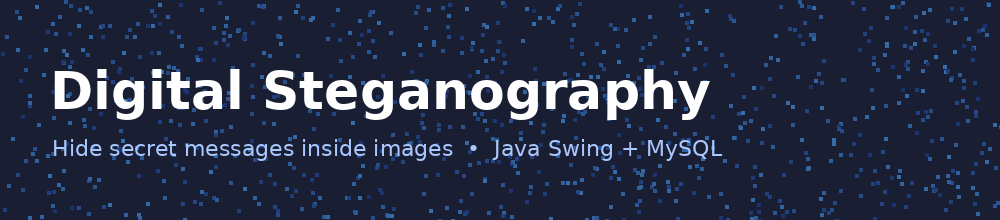
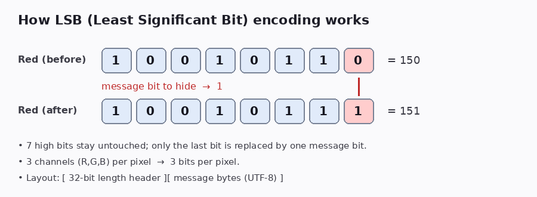
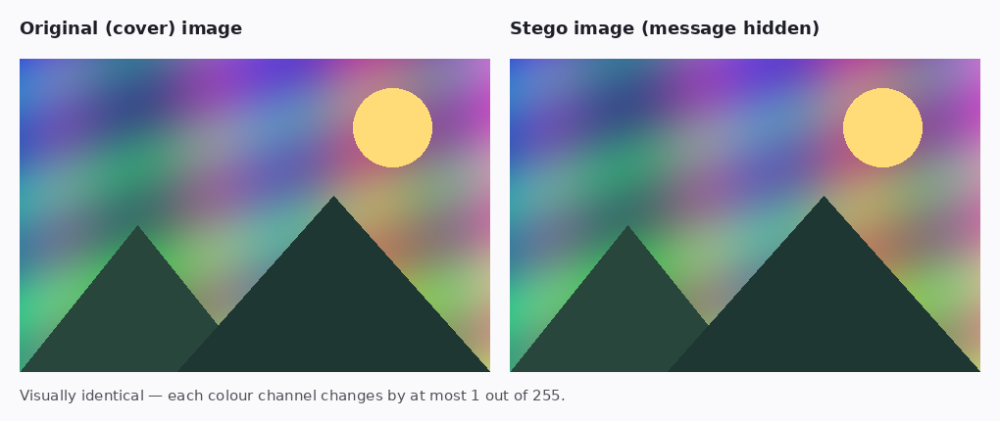
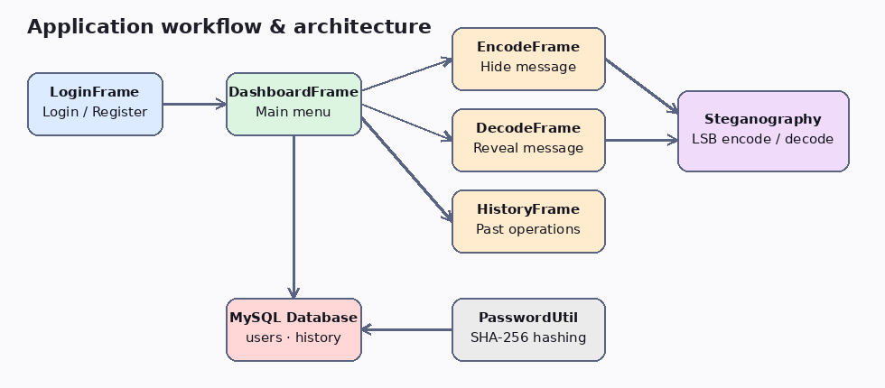

<p align="center">
  
</p>

<p align="center">
  
  
  
  
</p>

# 🕵️ Digital Steganography

A Java desktop application that **hides secret text messages inside images** using
**LSB (Least Significant Bit) steganography**, and extracts them again. It includes
user registration/login, a dashboard, and a per-user history of every encode/decode operation
stored in MySQL.

---

## ✨ Features

- 🔐 **User accounts** – register and log in (passwords stored as SHA-256 hashes)
- 🖼️ **Encode** – hide a UTF-8 text message inside any image and save it as a lossless PNG
- 🔍 **Decode** – extract the hidden message from a stego image
- 📜 **History** – view your past encode/decode operations (image name, message length, date)
- 📏 **Capacity check** – warns you when the message is too large for the chosen image
- 🧩 Simple Swing UI: Login → Register → Dashboard → Encode / Decode / History

---

## 🧠 How It Works

Every pixel has three colour channels (Red, Green, Blue), each stored as 8 bits.
Changing the **last bit** of a channel alters its value by at most 1 (out of 255) — invisible
to the human eye. The app replaces those last bits with the bits of your message.

<p align="center">
  
</p>

**Data layout inside the image**

```
[ 32-bit message length ][ message bytes (UTF-8) ]
```

- Bits are written row by row, left to right, 3 bits per pixel (R, G, B).
- Capacity = `width × height × 3` bits → roughly `width × height × 3 / 8` bytes, minus 4 for the header.
- Output is always saved as **PNG** (lossless). Saving as JPEG would destroy the hidden bits.

### Example result

<p align="center">
  
</p>

> The sample above was generated with the same algorithm used in `Steganography.java`.
> The two images are visually indistinguishable.

| Cover image | Stego image |
|:---:|:---:|
|  |  |

---

## 🏗️ Architecture

<p align="center">
  
</p>

### Project structure

```
DigitalSteganography/
├── src/digitalsteganography/
│   ├── Main.java                # Entry point – opens LoginFrame
│   ├── LoginFrame.java          # Login screen
│   ├── RegisterFrame.java       # Account creation
│   ├── DashboardFrame.java      # Main menu (Encode / Decode / History / Logout)
│   ├── EncodeFrame.java         # Select image, enter message, save stego PNG
│   ├── DecodeFrame.java         # Select stego image, reveal message
│   ├── HistoryFrame.java        # Table of previous operations
│   ├── Steganography.java       # LSB encode/decode logic
│   ├── PasswordUtil.java        # SHA-256 password hashing
│   ├── DatabaseConnection.java  # JDBC connection helper
│   ├── DatabaseTest.java        # Quick DB connectivity check
│   └── users.java               # Logged-in user model
├── docs/images/                 # README images
└── README.md
```

---

## 🛠️ Tech Stack

| Layer | Technology |
|---|---|
| Language | Java (JDK 25 configured in IntelliJ; earlier modern JDKs should also work) |
| GUI | Java Swing |
| Database | MySQL 8+ |
| DB driver | MySQL Connector/J |
| Image I/O | `javax.imageio`, `BufferedImage` |
| IDE | IntelliJ IDEA |

---

## 🚀 Getting Started

### 1. Prerequisites

- JDK installed
- MySQL Server running locally
- [MySQL Connector/J](https://dev.mysql.com/downloads/connector/j/) JAR

### 2. Clone the repository

```bash
git clone https://github.com/<your-username>/DigitalSteganography.git
cd DigitalSteganography
```

### 3. Create the database

Run this in MySQL (the schema is derived from the SQL queries used in the code):

```sql
CREATE DATABASE digital_steganography;
USE digital_steganography;

CREATE TABLE users (
    user_id  INT AUTO_INCREMENT PRIMARY KEY,
    username VARCHAR(50)  NOT NULL UNIQUE,
    email    VARCHAR(100) NOT NULL,
    password VARCHAR(64)  NOT NULL          -- SHA-256 hex digest
);

CREATE TABLE steganography_history (
    history_id     INT AUTO_INCREMENT PRIMARY KEY,
    user_id        INT NOT NULL,
    operation      VARCHAR(10)  NOT NULL,   -- 'ENCODE' or 'DECODE'
    image_name     VARCHAR(255) NOT NULL,
    message_length INT NOT NULL,
    operation_date TIMESTAMP DEFAULT CURRENT_TIMESTAMP,
    FOREIGN KEY (user_id) REFERENCES users(user_id)
);
```

### 4. Configure the connection

Edit `src/digitalsteganography/DatabaseConnection.java`:

```java
private static final String URL      = "jdbc:mysql://localhost:3306/digital_steganography";
private static final String USER     = "your_mysql_user";
private static final String PASSWORD = "your_mysql_password";
```

> ⚠️ **Security tip:** never commit real database credentials to GitHub. Consider reading them
> from environment variables (`System.getenv("DB_PASSWORD")`) instead, and rotate any password
> that was already committed.

### 5. Add the MySQL driver

In IntelliJ: **File → Project Structure → Libraries → + → Java** and select
`mysql-connector-j-<version>.jar`.

### 6. Run

Run `Main.java`. The login window opens.

Or from the command line:

```bash
javac -cp "path/to/mysql-connector-j.jar" -d out src/digitalsteganography/*.java
java  -cp "out:path/to/mysql-connector-j.jar" digitalsteganography.Main      # Linux / macOS
java  -cp "out;path/to/mysql-connector-j.jar" digitalsteganography.Main      # Windows
```

---

## 📖 Usage

1. **Register** a new account, then **log in**.
2. On the **Dashboard**, choose **Encode Message**:
   select a cover image → type your secret message → *Encode & Save* → a PNG is written (default name `encoded_image.png`).
3. Share the PNG. The recipient opens **Decode Message**, selects it and reads the hidden text.
4. Open **View History** to see all your previous operations.

---

## 📸 Application Screenshots

Add your own screenshots to `docs/images/` and uncomment the lines below:

<!--
| Login | Dashboard |
|:---:|:---:|
|  |  |

| Encode | Decode |
|:---:|:---:|
|  |  |


-->

---

## ⚠️ Limitations

- Output must stay **PNG** (or another lossless format); JPEG compression destroys the message.
- The message is **not encrypted** – anyone who knows LSB steganography can extract it. For real secrecy, encrypt the text before encoding.
- Plain SHA-256 password hashing is unsalted; use bcrypt/Argon2 for production use.

## 🔮 Future Improvements

- AES encryption of the message before embedding
- Password-protected stego images
- Salted password hashing (bcrypt / Argon2)
- Support for hiding files, not just text
- Image preview and drag-and-drop in the UI

## 🤝 Contributing

Pull requests are welcome. Fork the repo, create a feature branch, and open a PR.


